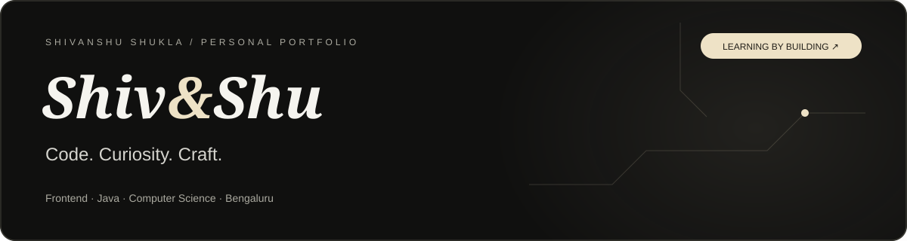
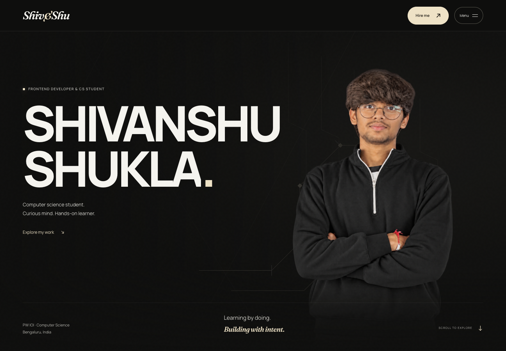
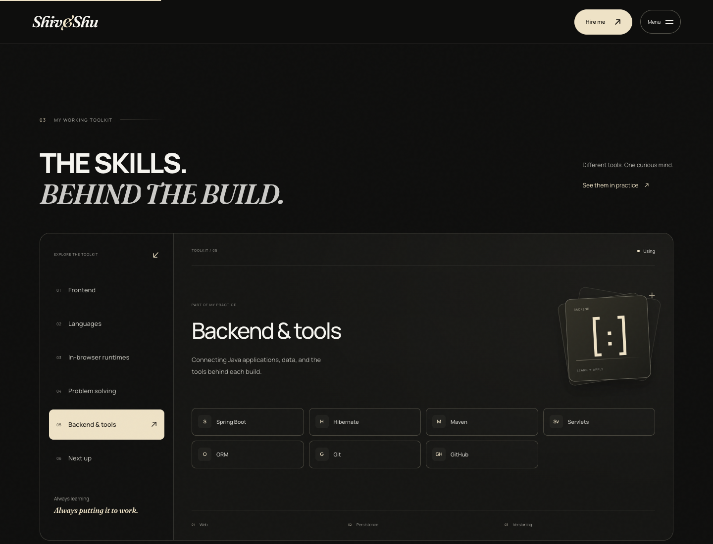

<p align="center">
  
</p>

<p align="center">
  <strong>A little about me. A closer look at what I build.</strong><br />
  My personal portfolio, built with HTML, CSS, and JavaScript.
</p>

<p align="center">
  <strong>Live deployment: awaiting Vercel sign-in</strong>
  &nbsp; · &nbsp;
  <a href="https://github.com/shivanshushukla2602-hash">GitHub</a>
  &nbsp; · &nbsp;
  <a href="https://www.linkedin.com/in/shivanshu-shukla-09a373377/">LinkedIn</a>
  &nbsp; · &nbsp;
  <a href="mailto:shivanshushukla2602@gmail.com">Say hello</a>
</p>

<p align="center"></p>

## Hi, I’m Shivanshu 👋

I’m a computer science student at **PW IOI, Bengaluru**. I work with Java and JavaScript, practise DSA, and learn by building things people can use.

This website brings my skills, projects, learning journey, and contact details into one place.

## Take a look around

| Section | What you’ll find |
| --- | --- |
| **Home** | A portrait that moves with your scroll, plus a quick introduction. |
| **About** | Who I am and what I’m working towards. |
| **Toolkit** | Interactive categories for languages, frontend, backend, DSA, and what’s next. |
| **Selected work** | Five projects on a rotating 3D axis. Drag, swipe, or use the arrow buttons. |
| **Journey** | Click-to-open notes about my studies and learning. |
| **Hire me** | My interests and a simple way to start a conversation. |

<details>
<summary><strong>Preview the interactive toolkit ↗</strong></summary>
<br />

</details>

## Projects, with a purpose

| Project | Made for | The idea |
| --- | --- | --- |
| [**PyCosmos**](https://github.com/shivanshushukla2602-hash/PyCosmos) | Personal platform | Bring Python learning, quizzes, and browser-based practice together. |
| [**SevaRecover**](https://github.com/shivanshushukla2602-hash/SevaRecover) | Amazon Buildathon | Help people understand rejected public-service applications and their next steps. |
| [**InnovateX**](https://github.com/shivanshushukla2602-hash/InnovateX) | End-semester project | Give a team’s profiles and shared work a home on the web. |
| [**SpendWise**](https://github.com/shivanshushukla2602-hash/SpendWise-old) | End-semester project | Explore a clearer interface for budgets and everyday money information. |
| [**Bus Reservation System**](https://github.com/shivanshushukla2602-hash/Bus-Reservation-System) | End-semester project | Connect seat booking and passenger records to a relational database. |

The portfolio includes the exported **SevaRecover interface demo**. Live analysis and sign-in require its separate backend. The other projects link to their own repositories or live platform.

## Small details, by design

- **Charcoal + pearl:** quiet colours, bold type, and locally hosted Manrope and Fraunces fonts.
- **Motion with purpose:** scroll effects, layered graphics, and an interactive project axis.
- **Made for different screens:** mouse, touch, and keyboard controls.
- **Motion preferences respected:** device reduced-motion settings switch to calmer layouts.
- **Readable without JavaScript:** content and native navigation remain available.
- **Contact without guesswork:** prepare a message, then open an email app, use Gmail, or copy it. The website does not send messages itself.

## Run it locally

No build step or package installation is needed for the portfolio.

```bash
git clone https://github.com/shivanshushukla2602-hash/My-Portfolio.git
cd My-Portfolio
python3 -m http.server 8080
```

Open **http://localhost:8080**. Serve the folder over HTTP so the included project demo loads correctly.

## Where things live

```text
My-Portfolio/
├── index.html         # Page content and sections
├── styles.css         # Layout, colours, responsive styles, and motion
├── portfolio.js       # Tabs, project axis, menu, and contact interactions
├── assets/
│   ├── fonts/         # Local fonts and their licenses
│   └── images/        # Portraits and project screenshots
├── clones/            # Included static demos and retained earlier work
├── docs/images/       # README artwork and actual site previews
└── vercel.json        # Static hosting configuration
```

To personalise it, edit the text and links in `index.html`, the theme in `styles.css`, and interactions in `portfolio.js`.

## Deployment

**Live website:** Waiting for Vercel sign-in. The deployment link will be added here once published.

Hosted on **Vercel** as a static website. There is no portfolio server or database to configure. The included project demos keep their own requirements.

---

<p align="center">
  <strong>Always learning. Always putting it to work.</strong><br />
  Built by <a href="https://github.com/shivanshushukla2602-hash">Shivanshu Shukla</a> · Bengaluru, India
</p>
